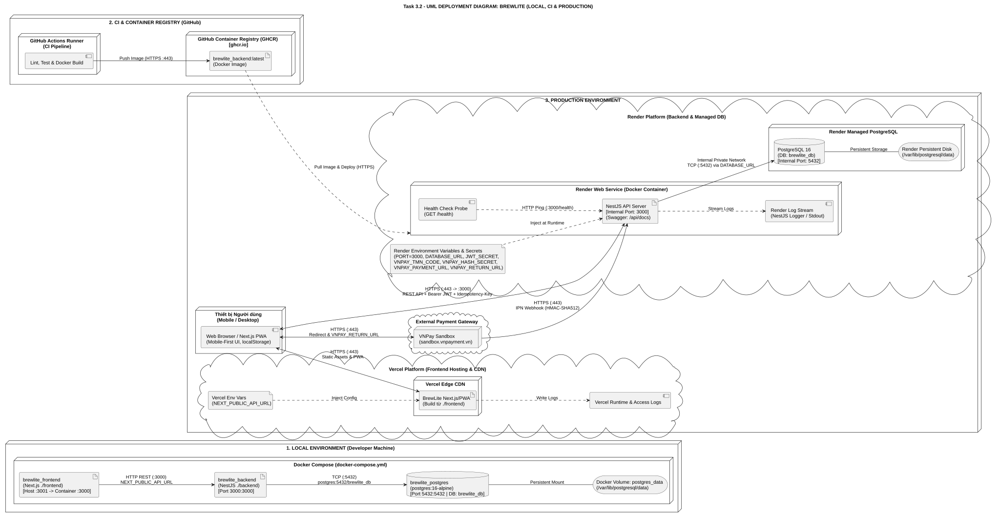

# Task 3 — Tài liệu Thiết kế Kiến trúc Hệ thống (BrewLite)

**Dự án:** BrewLite — Assignment 2: Requirements to Deployment  
**Tham chiếu:** SRS (`docs/requirements/srs.md`), Use-Case (`task1.3-use-case-checkout.md`), Diagrams (`docs/diagrams/`)

---

## 1. Kiến trúc Frontend (Next.js & PWA) — [Phụ trách: Bạn D]
- **Sơ đồ C4 Context & Container:** ``
- **Tổ chức phân lớp Next.js:** (Điền mô tả Pages/App Router, Components Mobile-first, `CartContext` + `localStorage`)
- **Cấu hình PWA:** (Điền mô tả `manifest.json`, icons, Service Worker và cách hoạt động trên trình duyệt di động/desktop)
- **ADR liên quan:** [ADR-002: Next.js PWA & Client-side Cart State](./adr/002-nextjs-pwa-and-client-cart.md)

## 2. Kiến trúc Backend (NestJS Modular Monolith) — [Phụ trách: Bạn C]
- **Sơ đồ C4 Backend Component:** ``
- **Kiến trúc phân lớp & Module:** (Điền luồng Request qua Controller -> ValidationPipe -> JwtAuthGuard -> Domain Services -> PrismaService; liệt kê các module `Auth`, `Products`, `Orders`, `Payments`, `Promotions`, `Health`)
- **ADR liên quan:** [ADR-003: Modular Monolith với NestJS](./adr/003-modular-monolith-nestjs.md)

## 3. Cơ sở dữ liệu PostgreSQL & Cơ chế Migration — [Phụ trách: Bạn E]

### 3.1. Vai trò và phương pháp tổ chức dữ liệu

BrewLite sử dụng **PostgreSQL** làm cơ sở dữ liệu quan hệ tập trung; **Prisma ORM** đảm nhiệm ánh xạ model và thao tác dữ liệu từ ứng dụng NestJS. Lựa chọn này phục vụ các nghiệp vụ đòi hỏi tính nhất quán: xác thực tài khoản, tạo đơn, lưu chi tiết món, thanh toán, giữ/hoàn nguyên liệu, khuyến mãi và tích điểm. Kiến trúc được tổ chức theo một NestJS API kết nối PostgreSQL qua `PrismaService`, thay vì để trình duyệt truy cập thẳng cơ sở dữ liệu.

Schema của Assignment 1 (`backend/prisma/schema.prisma`) có **11 model** chia làm ba cụm:

| Cụm nghiệp vụ | Model và vai trò |
|---|---|
| Tài khoản – Đơn hàng – Thanh toán | `User`, `Order`, `OrderItem`, `Payment`, `LoyaltyTransaction`: lưu người dùng, đơn đặt hàng, dòng món, giao dịch và lịch sử điểm |
| Sản phẩm – Tồn kho nguyên liệu | `Product`, `Ingredient`, `RecipeItem`, `ToppingRecipe`, `OrderIngredient`: thông tin món, nguyên liệu, định lượng công thức/topping và lượng nguyên liệu đã giữ cho từng đơn |
| Khuyến mãi | `Promotion`: mã giảm giá và các điều kiện áp dụng |

Các ràng buộc quan trọng gồm `User.email @unique`, `Promotion.code @unique`, `Payment.idempotencyKey @unique`, `LoyaltyTransaction.orderId @unique` và khóa chính kép `OrderIngredient(orderId, ingredientId)`. `Order` có quan hệ một-nhiều với `OrderItem`, `Payment` và `OrderIngredient`. Trong **mô hình nghiệp vụ**, mỗi đơn phải có **ít nhất một** dòng món (`Order 1 — 1..* OrderItem`); quy tắc tối thiểu này do API kiểm tra khi tạo đơn, không chỉ dựa vào khai báo quan hệ `OrderItem[]` trong Prisma.

### 3.2. Truy cập dữ liệu, giao dịch và kiểm soát tranh chấp

Tại backend, `PrismaModule` cung cấp `PrismaService`; service này kế thừa `PrismaClient`, kết nối trong `onModuleInit()` và ngắt kết nối trong `onModuleDestroy()`. Các lớp dịch vụ gọi Prisma trong backend, không trả thông tin kết nối database cho client.

Khi khách tạo đơn (`POST /orders`), backend kiểm tra xác thực, validate các dòng món, tính giá ở server, xác định nhu cầu nguyên liệu rồi thực hiện **một interactive transaction** với `prisma.$transaction(async tx => ...)`. Trong transaction này, backend kiểm tra nguyên liệu, giữ tồn kho và tạo bản ghi `Order` (`PENDING`), `OrderItem` cùng `OrderIngredient`. Nếu có lỗi xác thực nghiệp vụ, thiếu nguyên liệu hoặc tranh chấp cập nhật, transaction bị hủy để không lưu đơn dở dang hoặc giữ kho nửa chừng.

Để hạn chế bán vượt kho khi nhiều yêu cầu đặt đồng thời, `Ingredient` có hai trường `stock` và `version`. Hàm `reserveIngredients()` sử dụng **Optimistic Locking** theo nguyên tắc so sánh-và-cập-nhật:

```typescript
const updated = await tx.ingredient.updateMany({
  where: {
    id: ingredient.id,
    version: ingredient.version,
    stock: { gte: requiredQuantity },
  },
  data: {
    stock: { decrement: requiredQuantity },
    version: { increment: 1 },
  },
});
if (updated.count !== 1) {
  throw new ConflictException('Tồn kho đã thay đổi. Vui lòng thử lại');
}
```

*Đoạn minh họa được rút gọn từ* `backend/src/orders/ingredient-stock.ts` *của Assignment 1.* Trạng thái `version` thay đổi khiến lần cập nhật sử dụng phiên bản cũ không còn khớp điều kiện. Mọi cập nhật được thực hiện trong transaction; nếu một nguyên liệu không đủ, các cập nhật thành công trước đó cũng phải được rollback. Backend ghi `OrderIngredient` và `ingredientsReserved` để hỗ trợ kiểm soát giữ/hoàn nguyên liệu, tránh hoàn hai lần. Quyết định và trade-off được giải thích ở [ADR-005](adr/005-postgresql-prisma-optimistic-lock.md).

### 3.3. Quản lý thay đổi schema bằng Prisma Migrate

| Môi trường | Quy trình/ lệnh | Mục đích |
|---|---|---|
| Local (phát triển) | `npx prisma migrate dev --name <ten_thay_doi>` | Tạo SQL migration từ thay đổi schema và áp dụng lên DB phát triển |
| Local/CI | `npx prisma generate` và `npx prisma migrate status` | Sinh Prisma Client (khi cần), kiểm tra migration chưa áp dụng |
| Staging/Production | `npx prisma migrate deploy` | Chỉ chạy migration **đã được commit**; không tự sinh migration mới và không tự chạy seed |

Quy trình phát hành: sửa schema → tạo migration ở local → review SQL và tính tương thích ngược → commit cả schema và migrations → chạy CI → sao lưu database và chạy `migrate deploy` trên kết nối production an toàn → triển khai API → kiểm tra health/smoke test. **Không dùng `migrate dev`, `migrate reset` hoặc `db push` để thay thế kiểm soát migration trong production.** Việc kích hoạt migration phải được cấu hình rõ trong pipeline/deploy của nhóm; Render pre-deploy là một lựa chọn **nếu gói dịch vụ hỗ trợ**.

### 3.4. Truy vết SRS và tiêu chí kiểm chứng

| Yêu cầu SRS | Liên hệ kiến trúc Mục 3 | Minh chứng/kiểm thử cần đối chiếu |
|---|---|---|
| **FR-03**, AC-03.3 | Từ chối tạo đơn khi giỏ rỗng; dữ liệu giỏ không thay thế ràng buộc phía backend | Validate DTO và test `POST /orders` giỏ rỗng (A2 cần xác minh) |
| **FR-04**, AC-04.2 | `User.email @unique` ngăn tạo tài khoản trùng ở DB | `schema.prisma`, test email trùng trả 409 |
| **FR-05**, AC-05.3–05.6 | Backend tính lại giá; transaction tạo `Order`/`OrderItem` và giữ kho; `Ingredient.version` phát hiện tranh chấp | `orders.service.ts`, `ingredient-stock.ts` (A1); integration test 5 request, đúng 1 đơn được chấp nhận và không có tồn kho âm (A2 cần xác minh) |
| **FR-06**, AC-06.2–06.3, AC-06.6 | `Payment.idempotencyKey @unique` và giao dịch DB xử lý một sự kiện thanh toán/IPN an toàn; không mở transaction xuyên suốt việc chờ VNPay | `schema.prisma`, test callback trùng/đơn trùng (A2 cần xác minh) |
| **FR-08**, AC-08.3–08.4 | Chuyển trạng thái và hoàn nguyên liệu phải cập nhật atomically, không hoàn hai lần | `OrderIngredient`, `ingredientsReserved`; test hủy/thất bại/retry (A2 cần xác minh) |
| **FR-12** | Prisma Migration và seed phải tái tạo database mẫu trong **test**; health check được thiết kế ở Mục 5 | Migration + seed A1 là tham chiếu; cấu hình và kết quả chạy lại trên A2 chưa xác nhận |
| **NFR-01**, AC-NFR-01.2–01.3 | Kiểm soát đồng thời, trả lỗi có cấu trúc và rollback khi conflict | Test 5 request/1 suất nguyên liệu, kiểm tra không có đơn dở dang |
| **NFR-02**, AC-NFR-02.2 | Bảo vệ `DATABASE_URL` và secrets bằng biến môi trường | `.env.example`, config, kiểm tra không commit khóa thật |
| **NFR-04**, AC-NFR-04.2–04.4 | Migration/seed tái tạo môi trường, lưu DB bền vững và quản lý secrets | Docker Compose, README và log thử nghiệm ở A2 |
| **NFR-05** | Transaction và rollback bảo vệ toàn vẹn `Order`, `OrderItem`, tồn kho và cập nhật `Payment` theo từng nghiệp vụ | Kiểm thử rollback/Payment/IPN; không đồng nhất DB transaction với giao dịch ngoài qua VNPay |

## 4. Kiến trúc Dịch vụ Thanh toán (Mock & VNPay Sandbox) — [Phụ trách: Bạn C]
- **Tách biệt phương thức thanh toán:** (Giải thích luồng đồng bộ cho `WALLET`/`CARD` và luồng bất đồng bộ Redirect + IPN Webhook cho `VNPay Sandbox`)
- **Bảo mật giao dịch & Chống trùng lặp:** (Cơ chế `Idempotency-Key` và xác thực chữ ký `HMAC-SHA512`)
- **ADR liên quan:** [ADR-004: Thanh toán Idempotent & Tích hợp VNPay IPN](./adr/004-idempotent-payment-vnpay.md)

## 5. Logging, Health Check & Quản lý Cấu hình — [Phụ trách: Bạn E]

### 5.1. Configuration / Environment Variables

Backend NestJS ở Assignment 1 đã sử dụng `ConfigModule.forRoot({ isGlobal: true })` trong `AppModule` và `ConfigService` để đọc cấu hình VNPay. Trong Assignment 2, tiếp tục dùng cấu hình theo môi trường, **không hardcode secrets** trong code hay Docker Compose. Các biến quan trọng:

| Biến | Vai trò | Bảo vệ |
|---|---|---|
| `DATABASE_URL` | Kết nối PostgreSQL; trong Docker local dùng hostname service `postgres`, production dùng kết nối riêng tư tới Render Postgres | Secret |
| `JWT_SECRET` | Khóa ký và xác thực JWT | Secret |
| `VNPAY_TMN_CODE` | Mã merchant VNPay Sandbox | Cấu hình riêng theo môi trường |
| `VNPAY_HASH_SECRET` | Khóa xác minh/chữ ký HMAC giao dịch VNPay | Secret |
| `VNPAY_PAYMENT_URL`, `VNPAY_RETURN_URL` | Endpoint VNPay và URL callback/return tương ứng từng môi trường | Cấu hình URL |
| `PORT` | Cổng mà NestJS lắng nghe, lấy từ `process.env.PORT` | Cấu hình runtime |

Local dùng `.env` (không commit) cùng `.env.example` chỉ có tên biến và giá trị mẫu không nhạy cảm. Production dùng **Render Environment Variables/Secrets**; tránh sao chép giá trị localhost, khóa Sandbox hoặc mật khẩu vào hệ thống production. Frontend trên Vercel chỉ nhận các biến **public thật sự cần thiết** (ví dụ API public URL), không nhận JWT/VNPay secret hoặc `DATABASE_URL`. Việc đổi tên biến, kết nối nội bộ Postgres và chu kỳ xoay secret do nhóm triển khai/cấu hình thực tế.

### 5.2. Health Check: thiết kế mới cho Assignment 2

**Trạng thái: tính năng bổ sung cần hiện thực trong Assignment 2 (FR-12, NFR-07)** Theo thiết kế, Assignment 2 bổ sung endpoint `GET /health` trong NestJS để kiểm tra khả năng phục vụ API, phục vụ Render HTTP Health Check và CI/CD smoke test. Hai khái niệm được phân biệt:

- **Liveness:** quá trình NestJS còn phản hồi (có thể tách `GET /health/live` nếu cần); không nhất thiết truy vấn DB.
- **Readiness:** `GET /health` xác minh API sẵn sàng và kết nối PostgreSQL được, ví dụ dùng Prisma `$queryRaw` với câu `SELECT 1` hoặc biện pháp tương đương, có timeout phù hợp.

| Điều kiện | Kết quả mong đợi của `GET /health` |
|---|---|
| API và PostgreSQL bình thường | HTTP **200**, JSON tối thiểu `{ "status": "ok", "database": "connected" }` |
| Không truy cập được PostgreSQL | HTTP **503**, JSON tối thiểu `{ "status": "error", "database": "unavailable" }` |

Tuyệt đối không xuất `DATABASE_URL`, mật khẩu, token hoặc thông tin cấu trúc nội bộ trong phản hồi health. Với Render, cấu hình Health Check Path thành `/health` **sau khi code được hiện thực**. Tại môi trường local, xác minh bằng `curl http://localhost:<PORT>/health`; trên production sử dụng URL HTTPS thực tế. Việc API có thể lắng nghe trên cổng khác nhau ở local/docker/Render phải dựa theo `PORT` runtime, không điền cứng một cổng production.

### 5.3. Logging và theo dõi lỗi

Phương án thiết kế cho Assignment 2: sử dụng **NestJS Logger** hoặc một logging interceptor/filter thống nhất; ghi các sự kiện quan trọng ở mức phù hợp: khởi động API/kết nối DB, lỗi xác thực (không lộ token), lỗi validate, request không thành công, tranh chấp nguyên liệu (`Ingredient.version`), chuyển trạng thái đơn không hợp lệ, IPN VNPay có chữ ký sai và lỗi migration/health-check.

Đề xuất mỗi log có `timestamp`, `level`, `module/action`, `requestId` (nếu có) và mã lỗi/ID bản ghi không nhạy cảm. Dùng `warn` cho nghiệp vụ bị từ chối có kiểm soát, `error` cho lỗi kỹ thuật; không log nội dung đầy đủ của request chứa thông tin nhạy cảm. **Không ghi `passwordHash`, mật khẩu, `Authorization` header, JWT, `DATABASE_URL`, `VNPAY_HASH_SECRET` hoặc chữ ký thanh toán nguyên văn.** Khi deploy, log stdout/stderr của container được nền tảng thu thập; chính sách lưu trữ/giám sát cụ thể cần cấu hình sau.

### 5.4. Kiểm thử vận hành và khả năng triển khai

- Local: xác minh `.env.example`, Docker Compose khởi động frontend/backend/PostgreSQL theo biến môi trường; kiểm tra `PrismaService` kết nối DB; chạy migration trên DB thử nghiệm.
- API: kiểm tra `GET /health` trả **200** khi DB hoạt động và **503** khi DB mất kết nối; không đưa secrets vào body.
- Logging: tạo request hợp lệ và request lỗi để kiểm tra mức log; kiểm tra log không lộ JWT/password/khóa VNPay; tái hiện tranh chấp kho để ghi cảnh báo có thể theo dõi.
- Production (theo kế hoạch nhóm): Vercel phục vụ Next.js, Render chạy API và PostgreSQL, image backend lưu ở GHCR; cấu hình secrets/health-check và migration trước khi triển khai.

### 5.5. Truy vết SRS và phạm vi bổ sung Assignment 2

| Yêu cầu SRS | Thiết kế trong Mục 5 | Tình trạng/điều cần chứng minh |
|---|---|---|
| **FR-12** | `GET /health` + quy trình migration/seed tái tạo DB test (xem Mục 3.3) | **Bổ sung trong Assignment 2**: hiện thực endpoint và cung cấp phản hồi/test; seed A1 đã có nhưng cần tái kiểm chứng ở A2 |
| **NFR-02**, AC-NFR-02.2, 02.5 | Bảo vệ secrets `JWT_SECRET`, `DATABASE_URL`, `VNPAY_HASH_SECRET`; không lộ token/chữ ký VNPay | Cấu hình và kiểm tra log/source trên Assignment 2; không đưa khóa thật vào Git |
| **NFR-04**, AC-NFR-04.2–04.4 | Docker/Render config, health check, migration/seed và README tái tạo môi trường | Tài liệu thiết kế; cần minh chứng `docker compose up --build`, restart và log triển khai |
| **NFR-07** | Health Check, log lỗi vận hành, không ghi dữ liệu nhạy cảm | **Bổ sung/chuẩn hóa trong Assignment 2**; cần kiểm chứng `GET /health`, tình huống lỗi và log đã che secrets |
| **NFR-08** | Sau khi API khởi động lại, có thể kiểm tra readiness và hỗ trợ xử lý lỗi kết nối có kiểm soát | Yêu cầu mức **Should**; cần test khởi động lại khi triển khai |
| **FR-05**, **NFR-01** | Log cảnh báo tranh chấp `Ingredient.version`, lỗi rollback | Chuẩn hóa logging ở Assignment 2, đối chiếu bài test concurrency |
| **FR-06** | Log IPN VNPay lỗi/chữ ký không hợp lệ nhưng không lộ chữ ký/secret | Cần test IPN và kiểm tra log thực tế |

## 6. Kiến trúc Triển khai Production (Task 3.2) — [Phụ trách: Bạn B]



- **Ranh giới giữa 3 môi trường:**
  - **Local Environment (`docker-compose.yml`):** Khởi chạy đồng thời 3 container cục bộ gồm `brewlite_frontend` (ánh xạ cổng máy thật `3001` vào cổng container `3000`), `brewlite_backend` (cổng `3000:3000`) và `brewlite_postgres` (`postgres:16-alpine`, cổng `5432:5432`, gắn ổ đĩa `postgres_data` tại `/var/lib/postgresql/data`).
  - **CI & Container Registry (`GitHub Actions` + `GHCR`):** Tự động kiểm tra mã nguồn (Lint, Test, Build), đóng gói Docker image từ `./backend/Dockerfile` và đẩy lên GitHub Container Registry (`ghcr.io`) với nhãn `brewlite_backend:latest`.
  - **Production Environment (`Vercel` + `Render` + `VNPay Sandbox`):** Phục vụ người dùng cuối trên trình duyệt di động/máy tính theo hướng Mobile-First / PWA.
- **Giao thức, Cổng kết nối & Lưu trữ bền vững:**
  - Thiết bị người dùng giao tiếp với **Vercel Edge CDN** (tải giao diện tĩnh & PWA) và **Render Web Service** (gọi REST API kèm `Bearer JWT` và `Idempotency-Key`) hoàn toàn qua giao thức **HTTPS (cổng 443)**.
  - Container **NestJS API Server** trên Render lắng nghe ở cổng nội bộ `3000` (`process.env.PORT ?? 3000`), kết nối tới **Render Managed PostgreSQL** (`brewlite_db`) qua mạng nội bộ riêng tư (**Internal Private Network, cổng TCP 5432**), không phơi bày Database ra Internet.
  - Dữ liệu PostgreSQL được lưu trữ trên **Render Persistent Disk** (`/var/lib/postgresql/data`), đảm bảo không mất dữ liệu khi khởi động lại dịch vụ.
- **Quản lý cấu hình, Health Check & Logging:**
  - Các biến môi trường và khóa bí mật (`PORT`, `DATABASE_URL`, `JWT_SECRET`, `VNPAY_TMN_CODE`, `VNPAY_HASH_SECRET`, `VNPAY_PAYMENT_URL`, `VNPAY_RETURN_URL`, `NEXT_PUBLIC_API_URL`) được tiêm trực tiếp lúc runtime từ trình quản lý cấu hình của Render và Vercel, không lưu cứng trong mã nguồn.
  - Render định kỳ gọi **Health Check Probe** (`GET /health` tại cổng nội bộ `3000`) để giám sát trạng thái container và thu thập toàn bộ log đầu ra (`stdout`) về **Render Log Stream**.
- **ADR liên quan:** [ADR-001: Tổ chức mã nguồn Monorepo và Hạ tầng triển khai Vercel + Render](./adr/001-monorepo-and-deployment.md)

## 7. Ma trận Truy vết Kiến trúc ↔ Mã nguồn (Traceability) — [Phụ trách: Bạn B]

| Node / Dịch vụ trên Sơ đồ Deployment (Task 3.2) | Thành phần Kiến trúc tương ứng (Task 3.1) | Vị trí tệp / thư mục thực tế trong Mã nguồn |
| :--- | :--- | :--- |
| **Client Device (Web Browser / Next.js PWA)** | Frontend Next.js theo hướng Mobile-First / PWA (Mục 1, ADR-002) | `frontend/` (`src/`, `public/`, `CartContext` lưu `localStorage`) |
| **Vercel Platform (Next.js Hosting & CDN)** | Tầng phân phối giao diện Next.js & quản lý cấu hình FE (Mục 1, Mục 5) | `frontend/`, cấu hình `NEXT_PUBLIC_API_URL` trong `docker-compose.yml` |
| **GHCR (`brewlite_backend:latest`) & GitHub Actions** | Quyết định đóng gói container & Monorepo CI/CD (ADR-001, Mục 6) | `backend/Dockerfile`, `docker-compose.yml` (`build: ./backend`) |
| **Render Web Service (`NestJS API Server :3000`)** | Backend NestJS theo module/domain (Mục 2, ADR-003) | `backend/src/main.ts` (`port = 3000`, `/api/docs`), `backend/src/app.module.ts` |
| **Render Managed PostgreSQL (`brewlite_db :5432`) + Persistent Disk** | PostgreSQL, cơ chế Prisma Migration & Optimistic Lock (Mục 3, ADR-005) | `backend/prisma/schema.prisma`, `backend/prisma/migrations/`, volume `postgres_data` trong `docker-compose.yml` |
| **VNPay Sandbox & Luồng Webhook IPN** | Dịch vụ thanh toán mô phỏng & VNPay Sandbox (Mục 4, ADR-004) | `backend/src/payments/`, các biến `VNPAY_*` trong `backend/.env.example` |
| **Render & Vercel Environment Variables / Secrets** | Quản lý cấu hình tách biệt mã nguồn (Mục 5) | `backend/.env.example` (`PORT`, `DATABASE_URL`, `JWT_SECRET`, `VNPAY_TMN_CODE`, `VNPAY_HASH_SECRET`, `VNPAY_PAYMENT_URL`, `VNPAY_RETURN_URL`) |
| **Health Check (`GET /health`) & Log Stream** | Logging, Health check và giám sát vận hành (Mục 5) | `backend/src/main.ts` (Logger), module health check trong `backend/src/` |