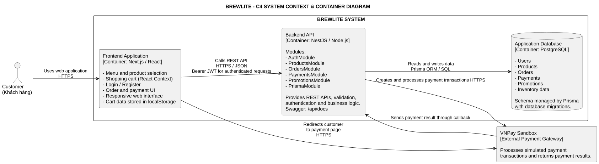

# Task 3 — Tài liệu Thiết kế Kiến trúc Hệ thống (BrewLite)

**Dự án:** BrewLite — Assignment 2: Requirements to Deployment  
**Tham chiếu:** SRS (`docs/requirements/srs.md`), Use-Case (`task1.3-use-case-checkout.md`), Diagrams (`docs/diagrams/`)

---

## 1. Kiến trúc Frontend (Next.js & PWA) — [Phụ trách: Bạn D]
### 1.1. Sơ đồ C4 Context & Container
Sơ đồ mô tả ranh giới hệ thống BrewLite, người dùng, các container chính và mối quan hệ với hệ thống thanh toán bên ngoài.

Các thành phần chính:
- **Customer:** Người dùng truy cập ứng dụng để xem thực đơn, quản lý giỏ hàng, đặt món và thanh toán.
- **Frontend Application:** Ứng dụng Next.js/React cung cấp giao diện và xử lý tương tác phía Client.
- **Backend API:** Ứng dụng NestJS cung cấp REST API, xử lý nghiệp vụ và xác thực yêu cầu.
- **Application Database:** PostgreSQL lưu trữ dữ liệu nghiệp vụ, được truy cập thông qua Prisma.
- **VNPay Sandbox:** Hệ thống thanh toán bên ngoài phục vụ tích hợp và kiểm thử giao dịch.

### 1.2. Tổ chức kiến trúc Frontend
Frontend sử dụng Next.js với App Router và React. Cấu trúc mã nguồn được tổ chức theo trách nhiệm:

| Thành phần | Vai trò |
|---|---|
| `app/` | Quản lý các trang và điều hướng như Menu, Cart, Login, Register, Orders và Order Confirmation. |
| `components/` | Chứa các thành phần giao diện có thể tái sử dụng. |
| `context/` | Quản lý trạng thái dùng chung bằng React Context, hiện có `CartContext`. |
| `lib/` | Chứa các hàm giao tiếp với Backend API, hiện có `api.ts`. |
| `public/` | Lưu trữ tài nguyên tĩnh của ứng dụng. |

Giao diện sử dụng Tailwind CSS và được xây dựng theo hướng responsive, hỗ trợ nhiều kích thước màn hình.

Luồng giao tiếp chính:

1. Người dùng tương tác với các trang và component thuộc Next.js.
2. Frontend sử dụng các hàm trong `lib/api.ts` để gửi HTTP request đến NestJS Backend.
3. Các yêu cầu cần xác thực gửi kèm Bearer JWT.
4. Backend xử lý nghiệp vụ và trả kết quả để Frontend cập nhật giao diện.

### 1.3. Quản lý trạng thái giỏ hàng phía Client
Giỏ hàng được quản lý bằng React Context thông qua `CartContext.tsx`, kết hợp `localStorage` để duy trì dữ liệu trên trình duyệt.

Các thao tác được cung cấp gồm:
- `addToCart`: Thêm sản phẩm vào giỏ hàng.
- `updateQty`: Cập nhật số lượng sản phẩm.
- `removeFromCart`: Xóa sản phẩm khỏi giỏ hàng.
- `clearFromCart`: Xóa toàn bộ dữ liệu giỏ hàng.
- `totalQty` và `totalPrice`: Tính tổng số lượng và tổng tiền để hiển thị.

Dữ liệu giỏ hàng được lưu tại khóa `brewlite_cart` trong `localStorage`. Cách tổ chức này giúp các trang có thể sử dụng chung trạng thái giỏ hàng và khôi phục dữ liệu sau khi tải lại trang.

**Ranh giới trách nhiệm:** Dữ liệu phía Client chỉ phục vụ hiển thị và tương tác. Backend vẫn phải xác thực sản phẩm, số lượng, giá và tồn kho trước khi tạo đơn hàng hoặc xử lý thanh toán.

### 1.4. Định hướng mở rộng Progressive Web App (PWA)
Assignment 2 định hướng mở rộng ứng dụng Next.js theo mô hình PWA nhằm cải thiện trải nghiệm trên thiết bị di động và hỗ trợ khả năng cài đặt ứng dụng.

Các thành phần dự kiến bổ sung:

- **Web App Manifest:** Khai báo tên ứng dụng, biểu tượng, màu giao diện và chế độ hiển thị.
- **Application Icons:** Cung cấp biểu tượng phù hợp với thiết bị và kích thước màn hình.
- **Service Worker:** Hỗ trợ caching các tài nguyên tĩnh phù hợp, cải thiện khả năng tải lại giao diện.
- **Responsive UI:** Tiếp tục ưu tiên thiết kế mobile-first và khả năng thích ứng với nhiều kích thước màn hình.

PWA không thay thế Backend. Những nghiệp vụ như kiểm tra tồn kho, tạo đơn hàng và thanh toán vẫn cần kết nối đến Backend API.

### 1.5. Quyết định kiến trúc liên quan
Tham chiếu [ADR-002: Next.js PWA và quản lý trạng thái giỏ hàng phía Client](./adr/002-nextjs-pwa-and-client-cart.md), trong đó trình bày lý do tiếp tục sử dụng Next.js, lựa chọn React Context kết hợp `localStorage`, định hướng PWA và các đánh đổi của phương án.

## 2. Kiến trúc Backend (NestJS Modular Monolith) — [Phụ trách: Bạn C]
- **Sơ đồ C4 Backend Component:** ``
- **Kiến trúc phân lớp & Module:** (Điền luồng Request qua Controller -> ValidationPipe -> JwtAuthGuard -> Domain Services -> PrismaService; liệt kê các module `Auth`, `Products`, `Orders`, `Payments`, `Promotions`, `Health`)
- **ADR liên quan:** [ADR-003: Modular Monolith với NestJS](./adr/003-modular-monolith-nestjs.md)

## 3. Cơ sở dữ liệu PostgreSQL & Cơ chế Migration — [Phụ trách: Bạn E]
- **Thiết kế dữ liệu & Ràng buộc:** (Liên kết tới `class-domain.svg` và `backend/prisma/schema.prisma`, nêu các khóa duy nhất `email`, `idempotencyKey`, `orderId` trên `LoyaltyTransaction`)
- **Cơ chế Migration & Seed:** (Giải thích quy trình `prisma/migrations/`, phân biệt `migrate dev` ở Local và `migrate deploy` + `seed` trên Production)
- **Kiểm soát đồng thời (Concurrency):** (Giải thích Database Transaction kết hợp Optimistic Locking bằng cột `version`)
- **ADR liên quan:** [ADR-005: PostgreSQL, Prisma Migration & Optimistic Locking](./adr/005-postgresql-prisma-optimistic-lock.md)

## 4. Kiến trúc Dịch vụ Thanh toán (Mock & VNPay Sandbox) — [Phụ trách: Bạn C]
- **Tách biệt phương thức thanh toán:** (Giải thích luồng đồng bộ cho `WALLET`/`CARD` và luồng bất đồng bộ Redirect + IPN Webhook cho `VNPay Sandbox`)
- **Bảo mật giao dịch & Chống trùng lặp:** (Cơ chế `Idempotency-Key` và xác thực chữ ký `HMAC-SHA512`)
- **ADR liên quan:** [ADR-004: Thanh toán Idempotent & Tích hợp VNPay IPN](./adr/004-idempotent-payment-vnpay.md)

## 5. Logging, Health Check & Quản lý Cấu hình — [Phụ trách: Bạn E]
- **Quản lý cấu hình (Config):** (Sử dụng `ConfigModule` nạp `.env`, tách biệt cấu hình Local và Production Secrets)
- **Health Check:** (Endpoint `GET /health` kiểm tra trạng thái API và kết nối PostgreSQL phục vụ Docker & Render)
- **Logging & Bảo mật dữ liệu nhạy cảm:** (Ghi log lỗi giao dịch, xung đột kho, sai chữ ký IPN; quy tắc che giấu mật khẩu, JWT và Hash Secret)

## 6. Kiến trúc Triển khai Production (Task 3.2) — [Phụ trách: Bạn B]

- **Ranh giới giữa 3 môi trường:**
  - **Local Environment (`docker-compose.yml`):** Khởi chạy đồng thời 3 container cục bộ gồm `brewlite_frontend` (ánh xạ cổng máy thật `3001` vào cổng container `3000`), `brewlite_backend` (cổng `3000:3000`) và `brewlite_postgres` (`postgres:16-alpine`, cổng `5432:5432`, gắn ổ đĩa `postgres_data` tại `/var/lib/postgresql/data`).
  - **CI & Container Registry (`GitHub Actions` + `GHCR`):** Tự động kiểm tra mã nguồn (Lint, Test, Build), đóng gói Docker image từ `./backend/Dockerfile` và đẩy lên GitHub Container Registry (`ghcr.io`) với nhãn `brewlite_backend:latest`.
  - **Production Environment (`Vercel` + `Render` + `VNPay Sandbox`):** Phục vụ người dùng cuối trên trình duyệt di động/máy tính theo hướng Mobile-First / PWA.
- **Giao thức, Cổng kết nối & Lưu trữ bền vững:**
  - Thiết bị người dùng giao tiếp với **Vercel Edge CDN** (tải giao diện tĩnh & PWA) và **Render Web Service** (gọi REST API kèm `Bearer JWT` và `Idempotency-Key`) hoàn toàn qua giao thức **HTTPS (cổng 443)**.
  - Container **NestJS API Server** trên Render lắng nghe ở cổng nội bộ `3000` (`process.env.PORT ?? 3000`), kết nối tới **Render Managed PostgreSQL** (`brewlite_db`) qua mạng nội bộ riêng tư (**Internal Private Network, cổng TCP 5432**), không phơi bày Database ra Internet.
  - Dữ liệu PostgreSQL được lưu trữ trên **Render Persistent Disk** (`/var/lib/postgresql/data`), đảm bảo không mất dữ liệu khi khởi động lại dịch vụ.
- **Quản lý cấu hình, Health Check & Logging:**
  - Các biến môi trường và khóa bí mật (`PORT`, `DATABASE_URL`, `JWT_SECRET`, `VNPAY_TMN_CODE`, `VNPAY_HASH_SECRET`, `VNPAY_PAYMENT_URL`, `VNPAY_RETURN_URL`, `NEXT_PUBLIC_API_URL`) được tiêm trực tiếp lúc runtime từ trình quản lý cấu hình của Render và Vercel, không lưu cứng trong mã nguồn.
  - Render định kỳ gọi **Health Check Probe** (`GET /health` tại cổng nội bộ `3000`) để giám sát trạng thái container và thu thập toàn bộ log đầu ra (`stdout`) về **Render Log Stream**.
- **ADR liên quan:** [ADR-001: Tổ chức mã nguồn Monorepo và Hạ tầng triển khai Vercel + Render](./adr/001-monorepo-and-deployment.md)

## 7. Ma trận Truy vết Kiến trúc ↔ Mã nguồn (Traceability) — [Phụ trách: Bạn B]

| Node / Dịch vụ trên Sơ đồ Deployment (Task 3.2) | Thành phần Kiến trúc tương ứng (Task 3.1) | Vị trí tệp / thư mục thực tế trong Mã nguồn |
| :--- | :--- | :--- |
| **Client Device (Web Browser / Next.js PWA)** | Frontend Next.js theo hướng Mobile-First / PWA (Mục 1, ADR-002) | `apps/web/` (`src/`, `public/`, `CartContext` lưu `localStorage`) |
| **Vercel Platform (Next.js Hosting & CDN)** | Tầng phân phối giao diện Next.js & quản lý cấu hình FE (Mục 1, Mục 5) | `apps/web/`, cấu hình `NEXT_PUBLIC_API_URL` trong `docker-compose.yml` |
| **GHCR (`brewlite_backend:latest`) & GitHub Actions** | Quyết định đóng gói container & Monorepo CI/CD (ADR-001, Mục 6) | `apps/api/Dockerfile`, `docker-compose.yml` (`build: ./apps/api`) |
| **Render Web Service (`NestJS API Server :3000`)** | Backend NestJS theo module/domain (Mục 2, ADR-003) | `apps/api/src/main.ts` (`port = 3000`, `/api/docs`), `apps/api/src/app.module.ts` |
| **Render Managed PostgreSQL (`brewlite_db :5432`) + Persistent Disk** | PostgreSQL, cơ chế Prisma Migration & Optimistic Lock (Mục 3, ADR-005) | `apps/api/prisma/schema.prisma`, `apps/api/prisma/migrations/`, volume `postgres_data` trong `docker-compose.yml` |
| **VNPay Sandbox & Luồng Webhook IPN** | Dịch vụ thanh toán mô phỏng & VNPay Sandbox (Mục 4, ADR-004) | `apps/api/src/payments/`, các biến `VNPAY_*` trong `apps/api/.env.example` |
| **Render & Vercel Environment Variables / Secrets** | Quản lý cấu hình tách biệt mã nguồn (Mục 5) | `apps/api/.env.example` (`PORT`, `DATABASE_URL`, `JWT_SECRET`, `VNPAY_TMN_CODE`, `VNPAY_HASH_SECRET`, `VNPAY_PAYMENT_URL`, `VNPAY_RETURN_URL`) |
| **Health Check (`GET /health`) & Log Stream** | Logging, Health check và giám sát vận hành (Mục 5) | `apps/api/src/main.ts` (Logger), module health check trong `apps/api/src/` |