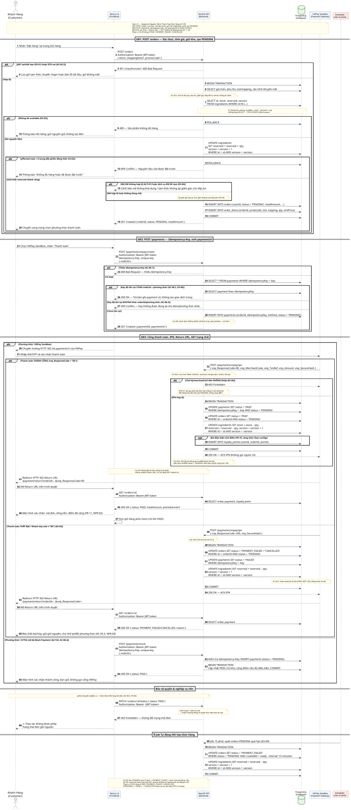

# Task 2.2 — Sequence Diagram: Đặt & Thanh Toán Đơn Hàng (UC-05)

> **Hệ thống:** BrewLite
> **Use-Case:** UC-05 — Đặt và Thanh Toán Đơn Hàng
> **Phiên bản:** 1.1 (Đồng bộ SRS Task 1.2 + Task 1.3)
> **Lifeline:** Khách Hàng → Next.js UI → NestJS API → PostgreSQL → VNPay Sandbox → Scheduler
> **File sơ đồ:** [`sequence-checkout.puml`](./sequence-checkout.puml) · **Render:** [`sequence-checkout.svg`](./sequence-checkout.svg)
> **Ngày:** 12/11/2026

Tài liệu này ghi lại các sửa đổi của sơ đồ tuần tự và đối chiếu 100% với SRS Task 1.2 (FR/NFR/AC) và đặc tả use-case Task 1.3 v1.2.

---

## 0. Kết quả render sơ đồ



> Sơ đồ gồm **71 message**, 3 giai đoạn chính + nhóm bảo vệ/nghiệp vụ nền; 9 khối `alt`, 1 khối `opt`.

---

## 1. Tổng hợp các nhóm sửa đổi & đồng bộ

| Mã | Nhóm sửa | Nội dung | Nguồn yêu cầu |
|---|---|---|---|
| **F1** | Tách endpoint | `POST /orders` tạo PENDING + giữ kho; `POST /payments/vnpay/create` mang `Idempotency-Key` + sinh `paymentUrl` | FR-05, FR-06; Task 1.3 Bước 7–8 |
| **F2** | Optimistic Locking | `UPDATE ... SET reserved = reserved + :qty, version = version + 1 WHERE id = :id AND version = :version`; bỏ `FOR UPDATE` | AC-05.4, NFR-01.3; Task 1.3 Bước 4 |
| **F3** | Bỏ push API→UI | VNPay redirect Return URL → UI gọi `GET /orders/:id`; không có mũi tên `API -> UI` | AC-06.7; AC-06.7 SRS |
| **F4** | Tính giá & lưu đơn | Backend tính lại giá/phụ thu/giảm (AC-05.3); lưu `userId`, OrderItem, tổng tiền, PENDING (AC-05.5) | AC-05.3, AC-05.5 |
| **F5** | Idempotency & IPN | Thiếu key → 400 (AC-06.1); trùng cùng đơn/phương thức → kết quả cũ (AC-06.2); dùng lại key đơn khác → 409 (AC-06.3); IPN verify HMAC + merchant + mã GD + số tiền (AC-06.5); callback lặp vô hại (AC-06.6) | AC-06.1…06.6 |
| **F6** | Hoàn kho & Return URL | Hoàn `reserved` đúng một lần (AC-08.4); Return URL chỉ hiển thị, trạng thái lấy từ backend (AC-06.7) | AC-08.4, AC-06.7 |
| **F7** | Phân quyền & loyalty | Chặn khách gọi `PATCH /orders/:id/status` → 403 (AC-08.5); điểm chỉ cộng khi PAID theo công thức config (FR-10) | AC-08.5, FR-10 |
| **F8** | Nghiệp vụ nền & phạm vi | Scheduler quét PENDING > 15 phút → FAILED + hoàn reserved (EX-09); UC dừng ở PAID/FAILED/CANCELLED; `PREPARING→READY→COMPLETED` là FR-13 Future | EX-09, AC-08.1, FR-13 |

---

## 2. Chi tiết các sửa đổi chính

### 2.1 F1 — Tách `POST /orders` và `POST /payments`

| Giai đoạn | Endpoint | Trách nhiệm | Phản hồi |
|---|---|---|---|
| GĐ1 | `POST /orders` | Xác thực JWT, validate DTO, tính giá server, giữ `reserved` bằng version, tạo Order `PENDING` + OrderItem | `201 { orderId, status: PENDING, totalAmount }` |
| GĐ2 | `POST /payments/vnpay/create` | Bắt buộc `Idempotency-Key`; kiểm tra trùng; tạo Payment `PENDING`; ký HMAC-SHA512 sinh `paymentUrl` | `201 { paymentId, paymentUrl }` |

### 2.2 F2 — Optimistic Locking (thay `FOR UPDATE`)

```sql
-- Đọc kèm version (không khóa dòng)
SELECT id, stock, reserved, version FROM ingredients WHERE id IN (...);

-- Giữ kho khi PENDING: điều kiện WHERE có version
UPDATE ingredients
SET    reserved = reserved + :qty,
       version  = version + 1
WHERE  id = :id AND version = :version;   -- affected rows = 0 => xung đột => ROLLBACK 409

-- Khi PAID: trừ stock, giải phóng reserved, version + 1
UPDATE ingredients SET stock = stock - :qty, reserved = reserved - :qty,
       version = version + 1 WHERE id = :id AND version = :version;

-- Khi FAILED/CANCELLED/hết hạn: chỉ giải phóng reserved (đúng 1 lần)
UPDATE ingredients SET reserved = reserved - :qty, version = version + 1
WHERE id = :id AND version = :version;
```

### 2.3 F3 — Luồng sau IPN (không push từ server)

```
PG -> API: IPN callback (verify HMAC/merchant/số tiền)
API -> DB: transaction cập nhật PAID / FAILED
API --> PG: 200 ACK IPN
PG --> Customer: Redirect 302 Return URL /payment/return?orderId=...
Customer -> UI: mở Return URL
UI -> API: GET /orders/:id (Bearer JWT-token)
API -> DB: SELECT order, payment, loyalty point
API --> UI: 200 { status, totalAmount, pointsEarned }
```

### 2.4 Bảng đối chiếu AC SRS ↔ sơ đồ

| AC SRS | Nội dung | Vị trí trong sơ đồ |
|---|---|---|
| AC-05.2 | Giỏ rỗng/qty ≤ 0/sai kiểu/productId lỗi → 400 | GĐ1 alt `JWT sai/DTO sai` |
| AC-05.3 | Backend tính lại giá, phụ thu, giảm, tổng | GĐ1 message `SELECT giá món, phụ thu...` + note AC-05.3 |
| AC-05.4 | Trừ/giữ kho + version trong transaction; không đủ → rollback; không kho âm | GĐ1 `UPDATE reserved + version`; alt `EX-02` (400/409) |
| AC-05.5 | Lưu `userId`, OrderItem, tổng tiền, PENDING | GĐ1 `INSERT orders` + `INSERT order_items` |
| AC-05.6 | 5 request đồng thời chỉ 1 thành công | GĐ1 alt `affected rows = 0` (409) |
| AC-06.1 | Thiếu `Idempotency-Key` → 400 | GĐ2 alt `Thiếu Idempotency-Key` |
| AC-06.2 | Trùng key cùng đơn/phương thức → không tạo trùng | GĐ2 alt `Key đã tồn tại CÙNG orderId` |
| AC-06.3 | Dùng lại key đơn/phương thức khác → từ chối | GĐ2 alt `Key khác orderId/phương thức` → 409 |
| AC-06.4 | Mock Payment không gọi VNPay | Nhánh `Mock Payment (ALT-02)` |
| AC-06.5 | IPN verify HMAC-SHA512, merchant, mã GD, số tiền | GĐ3 message IPN + note AC-06.5; alt `EX-05` → 403 |
| AC-06.6 | Callback lặp không tạo thu/điểm/hoàn kho lặp | `UPDATE ... WHERE status='PENDING'` + note AC-06.6 |
| AC-06.7 | Return URL không phải bằng chứng PAID | GĐ3 `GET /orders/:id` sau redirect; note F3 |
| AC-08.4 | Hoàn nguyên liệu đúng một lần | GĐ3 nhánh thất bại `UPDATE reserved - :qty` + note AC-08.4 |
| AC-08.5 | Khách không gọi được API vận hành | Nhánh `EX-10` → `PATCH` → 403 |
| AC-08.6 | PAID chỉ sau callback hợp lệ | GĐ3 `UPDATE orders PAID` trong transaction IPN hợp lệ |
| FR-10 | Điểm chỉ khi PAID, theo config | `opt Đủ điều kiện tích điểm` trong transaction PAID |
| NFR-07 | Log bảo mật, không lộ secret | Note trong alt `EX-05` |

---

## 3. Truy vết bước Task 1.3 ↔ message sơ đồ

| Bước Task 1.3 | Nội dung | Message sơ đồ | AC/FR |
|---|---|---|---|
| 1 | Xem lại giỏ hàng | `Customer -> UI: Nhấn "Đặt hàng"` | FR-03 |
| 2 | Kiểm tra JWT | GĐ1 alt `401/400` | AC-04.4, NFR-02 |
| 3 | Xác nhận giỏ, nhập KM | `POST /orders { promoCode? }` | FR-09 |
| 4 | Kiểm tra & giữ kho (Optimistic Lock) | `SELECT ... version`; `UPDATE reserved + version` | AC-05.4, NFR-01 |
| 5 | Thẩm định KM, tính giá server | `SELECT giá/phụ thu/KM`; alt `ALT-01/EX-04` | AC-05.3, FR-09 |
| 6 | Chọn phương thức | `Customer -> UI: Chọn VNPay/Mock` | AC-06.4 |
| 7 | `POST /orders` tạo PENDING | `INSERT orders/order_items`; `COMMIT`; `201` | AC-05.5 |
| 8 | `POST /payments` + Idempotency-Key + URL ký | GĐ2; alt 3 nhánh key; note HMAC | AC-06.1…06.3, AC-06.5 |
| 9 | Xác nhận tại cổng | `Customer -> PG: Nhập thẻ/OTP` | FR-06 |
| 10 | Xác minh IPN | `PG -> API: IPN`; note verify merchant/số tiền | AC-06.5 |
| 11 | PAID sau IPN hợp lệ | `UPDATE payments/orders PAID WHERE PENDING` | AC-08.6, AC-06.6 |
| 12 | Trừ kho vĩnh viễn | `UPDATE stock - reserved, version + 1` | AC-05.4, NFR-05 |
| 13 | Cộng điểm 1 lần khi PAID | `opt INSERT loyalty_points` | FR-10 |
| 14 | Return URL + GET trạng thái + dọn giỏ | `302 Return URL`; `GET /orders/:id`; `UI -> UI: Dọn giỏ` | AC-06.7, FR-11 |
| EX-02 | Hết hàng / lock conflict | alt `400` / alt `409` | AC-05.4, AC-05.6 |
| EX-03 | Hủy / thanh toán lỗi | Nhánh thất bại: FAILED/CANCELLED + hoàn reserved | AC-08.4 |
| EX-05 | IPN sai chữ ký | alt `403 Forbidden` + log NFR-07 | AC-06.5, NFR-02.5 |
| EX-06 | Key trùng | GĐ2 3 nhánh alt key | AC-06.1…06.3 |
| EX-09 | PENDING > 15 phút | `Sched -> API: Job 15 phút` | FR-08, AC-08.4 |
| EX-10 | Khách gọi PATCH trạng thái | alt `PATCH ... -> 403` | AC-08.5 |

---

## 4. Bộ kiểm thử TC-1.3 ↔ nhánh sơ đồ

| Mã TC | Tình huống | Nhánh/đối tượng trong sơ đồ |
|---|---|---|
| TC-1.3-01 | Đơn hợp lệ + KM + VNPay thành công | GĐ1 hợp lệ → GĐ2 → GĐ3 nhánh THÀNH CÔNG |
| TC-1.3-02 | 5 request đồng thời, kho đủ 1 đơn | alt `affected rows = 0` (409) |
| TC-1.3-03 | Mã KM sai/hết hạn | alt `ALT-01/EX-04` |
| TC-1.3-04 | IPN sai chữ ký | alt `EX-05` → 403, không điểm |
| TC-1.3-05 | Trùng Idempotency-Key cùng đơn | alt `Key CÙNG orderId` → 200 cũ |
| TC-1.3-06 | Hủy tại cổng | Nhánh THẤT BẠI → FAILED/CANCELLED + hoàn reserved |
| TC-1.3-07 | Token hết hạn | alt `401` + lưu giỏ, `/login` |
| TC-1.3-08 | Hết nguyên liệu | alt `Không đủ available` → 400, rollback |
| TC-1.3-09 | Lỗi CSDL trước commit | Rollback transaction (nguyên tắc NFR-05) |
| TC-1.3-10 | PENDING > 15 phút | `Sched -> API: Job 15 phút` |
| TC-1.3-11 | Thiếu key / key dùng lại đơn khác | alt `400`; alt `409` |
| TC-1.3-12 | Mở Return URL khi IPN chưa hợp lệ | `GET /orders/:id` trả PENDING, không công bố PAID |
| TC-1.3-13 | Khách gọi `PATCH` trạng thái | alt `EX-10` → 403 |
| TC-1.3-14 | IPN hợp lệ lặp 3 lần | `WHERE status='PENDING'` đảm bảo 1 lần chuyển |
| TC-1.3-15 | Mock Payment thành công | Nhánh `Mock Payment (ALT-02)` |

---

## 5. Checklist nghiệm thu

- [x] `POST /orders` không chứa `Idempotency-Key`, không trả `paymentUrl`
- [x] `POST /payments/vnpay/create` bắt buộc `Idempotency-Key`; unique theo đơn + phương thức
- [x] Toàn bộ cập nhật kho dùng điều kiện `AND version = :version`; không còn `FOR UPDATE`
- [x] Không có mũi tên `API -> UI`; kết quả hiển thị sau `GET /orders/:id`
- [x] PAID chỉ ghi sau IPN verify HMAC + merchant + mã GD + số tiền
- [x] `UPDATE ... WHERE status = 'PENDING'` chống chuyển trạng thái/điểm/kho lặp
- [x] Hoàn `reserved` đúng một lần ở FAILED/CANCELLED/hết hạn
- [x] Guard 403 cho `PATCH /orders/:id/status` của khách thường
- [x] Giỏ chỉ dọn ở nhánh PAID; giữ nguyên ở mọi nhánh lỗi
- [x] Ghi chú phạm vi: `PREPARING → READY → COMPLETED` thuộc FR-13 Future, ngoài UC-05

---

