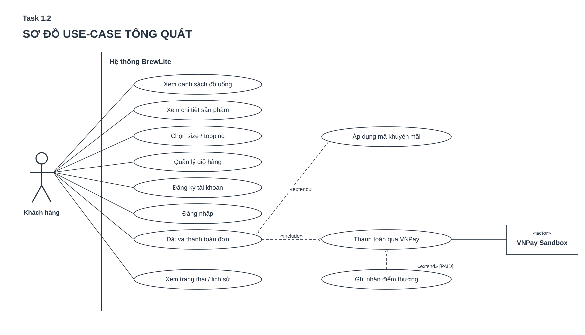

# Task 1.2 — Đặc tả yêu cầu phần mềm (SRS rút gọn)

**Dự án:** BrewLite — Assignment 2: Requirements to Deployment
**Tài liệu:** ngày 10/11/2026
**Công nghệ được yêu cầu:** Next.js (frontend), NestJS (backend), PostgreSQL (database)
**Phạm vi tài liệu:** Task 1.2 — yêu cầu chức năng, yêu cầu phi chức năng, mức ưu tiên, tiêu chí chấp nhận và sơ đồ use-case tổng quát.

## 1. Mục tiêu và phạm vi

BrewLite hỗ trợ khách hàng lựa chọn đồ uống, tùy chỉnh size/topping, quản lý giỏ hàng, đặt đơn, thanh toán không dùng tiền mặt bằng **cổng thanh toán mô phỏng**, nhận kết quả và xem lịch sử/trạng thái đơn. Mục tiêu là hoàn thiện luồng đầu-cuối **xem menu → chọn tùy chọn → giỏ hàng → đặt đơn → thanh toán → theo dõi đơn** trên giao diện ưu tiên thiết bị di động.

Các chức năng liên quan đến khuyến mãi, tích điểm, kiểm soát tồn kho và tính idempotency được giữ từ phạm vi BrewLite Assignment 1 và mã nguồn hiện có.

### 1.1. Tác nhân (actor) và giới hạn hệ thống

| Tác nhân | Vai trò tương tác | Phạm vi |
|---|---|---|
| **Khách hàng (Customer)** | Xem menu, chi tiết, tùy chỉnh, giỏ hàng, đăng ký/đăng nhập, đặt và thanh toán, xem đơn của mình | **Trong MVP** |
| **Cổng thanh toán mô phỏng (Mock Payment Gateway)** | Nhận yêu cầu thanh toán ví/thẻ từ backend và trả kết quả | **Trong MVP**; là dịch vụ ngoài ranh giới logic BrewLite |
| **Nhân viên quầy/Quản lý** | Tiếp nhận và cập nhật trạng thái pha chế/đơn hàng bằng giao diện được phân quyền | **Mở rộng**; không khẳng định đã có role/guard nghiệp vụ trong bản hiện tại |

Next.js, NestJS và PostgreSQL là **các thành phần kỹ thuật bên trong hệ thống**, không phải actor của use-case diagram.

### 1.2. Quy ước MoSCoW

| Nhãn | Ý nghĩa trong tài liệu |
|---|---|
| **Must** | Yêu cầu cần có để MVP/tiêu chí bắt buộc của Assignment 2 được nghiệm thu. |
| **Should** | Yêu cầu nên triển khai trong bản này, nhưng không làm thay đổi luồng tối thiểu khi chưa hoàn thành. |
| **Could** | Cải tiến tùy nguồn lực; không được báo cáo là đã hoàn tất nếu chưa có minh chứng. |
| **Won't (this release)** | Nằm ngoài phạm vi phát hành Assignment 2; có thể cân nhắc ở phiên bản sau. |

**Cách đọc tiêu chí:** `AC-FR-xx` và `AC-NFR-xx` là điều kiện có thể chạy test/demo, không tự động biểu thị `Pass`. Mã FR/NFR giữ nguyên so với SRS của ZIP gốc để tránh phá vỡ truy vết.

## 2. Yêu cầu chức năng (Functional Requirements)

### 2.1. Nhóm menu, sản phẩm và giỏ hàng

| ID | Yêu cầu | MoSCoW | Tiêu chí chấp nhận (Acceptance Criteria) |
|---|---|---|---|
| **FR-01** | **Xem danh sách đồ uống** | **Must** | **AC-FR-01:** `GET /products` trả HTTP 200 và danh sách từ dữ liệu seed/CSDL gồm ID, tên, giá, ảnh; web hiển thị menu, loading, empty và error rõ ràng. |
| **FR-02** | **Xem chi tiết sản phẩm** | **Must** | **AC-FR-02:** `GET /products/:id` trả thông tin của sản phẩm hợp lệ; ID không tồn tại trả 404; giao diện hiển thị giá và các tùy chọn liên quan. |
| **FR-03** | **Tùy chọn size và topping** | **Must** | **AC-FR-03:** Khách có thể chọn size/topping hợp lệ, giá tạm tính thay đổi theo lựa chọn; backend **tự tính lại** đơn giá khi tạo đơn, không tin giá gửi từ trình duyệt. |
| **FR-04** | **Quản lý giỏ hàng** | **Must** | **AC-FR-04:** Có thể thêm món, tăng/giảm số lượng, xóa món; số lượng và tổng tạm tính cập nhật đúng; không cho thực hiện đặt hàng khi giỏ rỗng. |

### 2.2. Nhóm tài khoản, đặt hàng và thanh toán

| ID | Yêu cầu | MoSCoW | Tiêu chí chấp nhận (Acceptance Criteria) |
|---|---|---|---|
| **FR-05** | **Đăng ký và đăng nhập** | **Must** | **AC-FR-05:** `POST /auth/register` tạo tài khoản hợp lệ với mật khẩu băm; `POST /auth/login` cấp JWT cho thông tin đúng và từ chối thông tin sai; trang riêng tư yêu cầu token hợp lệ. |
| **FR-06** | **Tạo đơn hàng** | **Must** | **AC-FR-06:** `POST /orders` cần Bearer JWT; từ chối giỏ rỗng, số lượng sai hoặc sản phẩm không tồn tại; đơn hợp lệ được lưu cùng các dòng đơn, tổng tiền phía server và trạng thái ban đầu `PENDING`. |
| **FR-07** | **Kiểm soát tồn kho khi đặt đồng thời** | **Must** | **AC-FR-07:** Khi hai yêu cầu tranh chấp phần tồn kho còn lại, không được bán quá lượng có sẵn hoặc tạo stock âm; nếu kiểm tra/cập nhật thất bại, transaction được rollback và trả thông báo lỗi. |
| **FR-08** | **Thanh toán không dùng tiền mặt (mô phỏng)** | **Must** | **AC-FR-08:** `POST /payments` chỉ chấp nhận `WALLET` hoặc `CARD`, kiểm tra JWT và chủ đơn; thành công tạo Payment và chuyển đơn sang `PAID`; thất bại được xử lý theo trạng thái `PAYMENT_FAILED` với kết quả hiển thị cho khách. |
| **FR-09** | **Ngăn thanh toán trùng (idempotency)** | **Must** | **AC-FR-09:** Cùng `Idempotency-Key`, đơn và phương thức: yêu cầu lặp lại nhận lại kết quả đã ghi (hoặc 409 khi giao dịch đang xử lý), không thu thêm lần nữa; key trùng cho payload khác trả 409. |
| **FR-10** | **Xem lịch sử và chi tiết đơn của chính mình** | **Must** | **AC-FR-10:** `GET /orders/me` chỉ trả các đơn của người đang đăng nhập, sắp theo mới nhất; `GET /orders/:id` không tiết lộ đơn của người khác. |
| **FR-11** | **Quản lý vòng đời trạng thái đơn** | **Must** | **AC-FR-11:** Hệ thống chỉ chấp nhận các chuyển trạng thái hợp lệ theo state machine (`PENDING`, `PAID`, `PAYMENT_FAILED`, `PREPARING`, `READY`, `COMPLETED`, `CANCELLED`); chuyển sai bị từ chối; không cho khách tự chuyển trạng thái đơn bằng API vận hành. |
| **FR-14** | **Xác nhận đơn và thông báo lỗi** | **Must** | **AC-FR-14:** Thanh toán thành công hiển thị mã đơn, trạng thái và tổng tiền; lỗi giỏ hàng/JWT/hết hàng/thanh toán có thông báo cụ thể, không dẫn đến trang trắng; giỏ không bị xóa do thất bại thanh toán. |

### 2.3. Nhóm khuyến mãi, tích điểm và vận hành kỹ thuật

| ID | Yêu cầu | MoSCoW | Tiêu chí chấp nhận (Acceptance Criteria) |
|---|---|---|---|
| **FR-12** | **Áp dụng mã khuyến mãi** | **Must** | **AC-FR-12:** Cho phép nhập mã; backend kiểm tra tồn tại, hiệu lực, thời hạn, mức đơn tối thiểu và loại giảm `PERCENT`/`FIXED`; không giảm quá tổng tạm tính; đơn lưu mức giảm/tổng cuối cùng. |
| **FR-13** | **Tích điểm khách hàng** | **Must** | **AC-FR-13:** Sau khi đơn được thanh toán thành công (`PAID`), ghi điểm theo `floor(total / 10.000)` VND; retry cùng giao dịch không cộng điểm lần thứ hai; lỗi/thất bại không cộng điểm. |
| **FR-15** | **API kiểm tra hoạt động** | **Must** | **AC-FR-15:** `GET /health` trả HTTP 200 khi API hoạt động, có thể dùng trong smoke test/deployment. |
| **FR-16** | **Khởi tạo dữ liệu bằng migration/seed** | **Must** | **AC-FR-16:** Có thể tái tạo CSDL mới bằng Prisma migration và seed; dữ liệu mẫu có sản phẩm và mã khuyến mãi; chạy lại seed không vô ý đặt lại tồn kho đang sử dụng. |

### 2.4. Ngoài phạm vi phát hành

| ID | Yêu cầu | MoSCoW | Điều kiện mở rộng trong tương lai |
|---|---|---|---|
| **FR-17** | **Giao diện/role nhân viên quầy để cập nhật trạng thái pha chế** | **Won't (this release)** | **AC-FR-17 (đối với phiên bản sau):** Có tài khoản nhân viên/role guard; khách hàng bị từ chối quyền cập nhật trạng thái (HTTP 403 hoặc quy tắc phân quyền đã tài liệu hóa); nhân viên chỉ được chuyển trạng thái hợp lệ. **Không tuyên bố tính năng này đã triển khai hoàn chỉnh.** |

**Ghi chú phạm vi:** FR-11 là **quy tắc trạng thái nghiệp vụ của backend trong MVP**, khác với FR-17 là **giao diện và phân quyền dành cho nhân viên quầy**. Một endpoint `PATCH /orders/:id/status` tồn tại **không đủ chứng minh** FR-17 đã hoàn thành.

## 3. Yêu cầu phi chức năng (Non-functional Requirements)

| ID | Thuộc tính chất lượng | MoSCoW | Tiêu chí chấp nhận (Acceptance Criteria) |
|---|---|---|---|
| **NFR-01** | **Bảo mật xác thực** | **Must** | **AC-NFR-01:** Mật khẩu được băm trước khi lưu; endpoint yêu cầu đăng nhập trả 401 khi thiếu/hết hạn/sai JWT; dữ liệu nhập được validate và từ chối payload không hợp lệ. |
| **NFR-02** | **Phân quyền và bảo vệ đơn hàng** | **Must** | **AC-NFR-02:** Người dùng A không xem/thanh toán đơn của B (403/404 theo API); tài khoản khách không được gọi thành công endpoint chuyển trạng thái nghiệp vụ dành cho vận hành; các lần thử bị từ chối không thay đổi trạng thái DB. |
| **NFR-03** | **Toàn vẹn và nhất quán dữ liệu** | **Must** | **AC-NFR-03:** Tạo đơn và trừ tồn kho nằm trong transaction; khi một bước thất bại, không lưu đơn nửa chừng hoặc thay đổi stock không nhất quán; kiểm thử cạnh tranh không làm tồn kho âm. |
| **NFR-04** | **Idempotency của thanh toán** | **Must** | **AC-NFR-04:** Có ràng buộc duy nhất cho `idempotencyKey`; thử hai request cùng key không tạo hai Payment thành công hay cộng loyalty hai lần. |
| **NFR-05** | **Responsive/mobile-first** | **Must** | **AC-NFR-05:** Trên các viewport 375×812 px và 390×844 px, có thể dùng luồng menu → tùy chọn → giỏ → thanh toán → kết quả mà không có cuộn ngang ngoài ý muốn, nội dung chính không bị che hoặc tràn. |
| **NFR-06** | **Khả năng bảo trì và chất lượng mã** | **Must** | **AC-NFR-06:** Backend tổ chức theo module/domain; web và API có lệnh lint/build/test được ghi trong README; CI thực thi quality gate và chặn merge PR khi có lỗi. Việc CI pass phải có log/URL chứng minh. |
| **NFR-07** | **Khả năng triển khai và tái tạo môi trường** | **Must** | **AC-NFR-07:** Có `.env.example`, `docker-compose.yml` chạy web + API + PostgreSQL ở local; Prisma migration/seed tái lập được DB; hướng dẫn chạy local và deploy được mô tả. |
| **NFR-08** | **Khả năng quan sát hệ thống** | **Must** | **AC-NFR-08:** API có `/health` kiểm tra được; log cơ bản ghi lỗi khởi động/yêu cầu thất bại để hỗ trợ debug, không in mật khẩu, JWT hoặc secrets. |
| **NFR-09** | **Hiệu năng với dữ liệu mẫu** | **Must** | **AC-NFR-09:** Mục tiêu kế thừa Assignment 1: `GET /products` phản hồi **dưới 500 ms** trong tối thiểu 19/20 lần đo sau khởi động/warm-up, dùng 10 sản phẩm seed, môi trường local xác định; báo cáo phải ghi phần cứng, cách đo, số liệu. **Chưa có số liệu thì chưa được kết luận đạt.** |
| **NFR-10** | **Bảo vệ bí mật cấu hình** | **Must** | **AC-NFR-10:** Không commit `.env`, mật khẩu, token hay khóa thật; cấu hình production dùng CI/hosting secrets; không đưa secrets vào log và ảnh minh chứng. |
| **NFR-11** | **Tính khả dụng (usability)** | **Must** | **AC-NFR-11:** Nút hành động quan trọng có nhãn rõ; các tình huống giỏ rỗng, yêu cầu đăng nhập, hết hàng và thanh toán lỗi có phản hồi dễ hiểu; người dùng có thể quay lại sửa giỏ/thử lại mà không mất danh sách món. |
| **NFR-12** | **Phục hồi sau lỗi dịch vụ ở môi trường demo** | **Should** | **AC-NFR-12:** Sau khi khởi động lại container API trên máy demo đã mô tả, `/health` quay lại 200 trong 60 giây; trong lúc API không kết nối được, UI hiển thị lỗi/thử lại thay vì kẹt ở loading vô hạn. Đây không phải cam kết uptime production. |
| **NFR-13** | **Khả năng mở rộng theo hướng PWA** | **Should** | **AC-NFR-13:** Nếu nhóm triển khai PWA, ứng dụng có manifest hợp lệ, icon và có thể cài từ trình duyệt hỗ trợ; nếu chưa triển khai, ghi rõ đây là kế hoạch mở rộng, không đánh dấu Pass. |

**Quy định đo lường NFR-09:** 500 ms lấy từ yêu cầu phi chức năng ở BrewLite Assignment 1.

## 4. Sơ đồ use-case tổng quát

- **Nguồn UML:** [`docs/diagrams/use-case.puml`](../diagrams/use-case-task1.2.puml).
- **Ảnh SVG:** [`docs/diagrams/use-case.svg`](../diagrams/use-case-task-1.2.svg).
- **Tệp kéo thả chỉnh sửa:** [`docs/diagrams/use-case.drawio`](../diagrams/use-case-task-1.2.drawio).

### 4.1. Quan hệ UML chính

| Quan hệ | Ý nghĩa |
|---|---|
| Khách hàng — các chức năng menu, chi tiết, tùy chỉnh, giỏ, tài khoản, đặt/thanh toán, lịch sử/trạng thái | Liên kết actor–use-case (**đường liền, không mũi tên**) |
| **Đặt và thanh toán đơn** `«include»` **Thanh toán ví/thẻ** | Bước thanh toán bắt buộc trong luồng đặt-thanh-toán thành công |
| **Áp dụng mã khuyến mãi** `«extend»` **Đặt và thanh toán đơn** | Chỉ xảy ra khi khách nhập mã khuyến mãi |
| **Tích điểm sau thanh toán** `«extend»` **Thanh toán ví/thẻ** | Chỉ khi giao dịch đã thành công (`PAID`) |
| Cổng thanh toán mô phỏng — **Thanh toán ví/thẻ** | Actor ngoài tương tác với nghiệp vụ thanh toán |

### 4.2. Đối chiếu use-case với yêu cầu

| Mã use-case | Tên nghiệp vụ | Yêu cầu liên quan |
|---|---|---|
| UC-G01 | Xem menu | FR-01 |
| UC-G02 | Xem chi tiết sản phẩm | FR-02 |
| UC-G03 | Chọn size/topping | FR-03 |
| UC-G04 | Quản lý giỏ hàng | FR-04 |
| UC-G05 | Đăng ký/đăng nhập | FR-05, NFR-01 |
| UC-G06 | Đặt và thanh toán đơn | FR-06, FR-07, FR-08, FR-09, FR-11, FR-14, NFR-02, NFR-03, NFR-04 |
| UC-G07 | Xem trạng thái/lịch sử đơn | FR-10, FR-11, NFR-02 |
| UC-G08 | Áp dụng khuyến mãi | FR-12 |
| UC-G09 | Thanh toán ví/thẻ (use-case được bao gồm) | FR-08, FR-09 |
| UC-G10 | Tích điểm sau thanh toán | FR-13 |

FR-15, FR-16 và các NFR về vận hành/triển khai là **yêu cầu hệ thống**, được kiểm chứng qua API, test, CI/CD và deployment, không cần dựng thành use-case riêng của khách hàng.

## 5. Quy tắc nghiệp vụ và các trường hợp ngoại lệ trọng yếu

1. **Tính giá:** Backend là nguồn dữ liệu tính giá chính thức; phụ thu size/topping và mức giảm đều phải được kiểm tra lại khi tạo đơn.
2. **Đặt đơn:** Khách cần đăng nhập và giỏ không rỗng. Tạo đơn và trừ tồn kho thực hiện atomically; đơn mới ở `PENDING`.
3. **Hết hàng:** Từ chối đơn hoặc báo tồn kho đã thay đổi; không để stock âm. UI cho phép khách sửa giỏ.
4. **Thanh toán:** Chỉ nhận `WALLET`/`CARD` mô phỏng; không nhận số thẻ thật. Gửi lại `Idempotency-Key` phải không tạo thêm giao dịch thành công.
5. **Thanh toán thất bại:** Trạng thái và hoàn/giữ tồn kho phải nhất quán theo quy tắc retry; giỏ hàng phải được giữ để khách xử lý tiếp.
6. **Khuyến mãi và loyalty:** Mã phải hợp lệ tại thời điểm đặt đơn; điểm chỉ cộng sau `PAID` và không cộng lặp.
7. **Truy cập dữ liệu:** Khách chỉ xem/thanh toán đơn của chính mình; mọi API cập nhật trạng thái vận hành phải có kiểm tra quyền phù hợp.