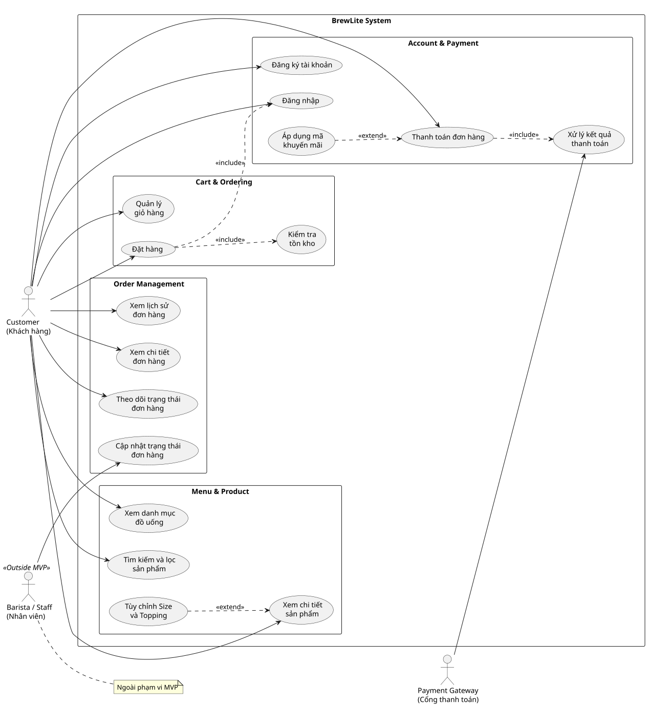

# YÊU CẦU PHẦN MỀM RÚT GỌN (SRS) - BREWLITE
Môn học: Công nghệ Phần mềm | Bài tập lớn: Assignment 2

---

## 1. Yêu cầu chức năng (Functional Requirements - FR)

### Nhóm 1: Trải nghiệm khách hàng & Giỏ hàng (Phụ trách: Bạn D)
* **FR-01: Hiển thị danh mục & Menu đồ uống**
  * Mô tả: ...
  * Mức ưu tiên (MoSCoW): Must
  * Tiêu chí chấp nhận (AC): ...
* **FR-02: Chi tiết & Tùy biến món (Size & Topping)**
  * Mô tả: ...
  * Mức ưu tiên (MoSCoW): Must
  * Tiêu chí chấp nhận (AC): ...
* **FR-03: Quản lý giỏ hàng (Cart)**
  * Mô tả: ...
  * Mức ưu tiên (MoSCoW): Must
  * Tiêu chí chấp nhận (AC): ...
* **FR-07: Lịch sử đơn hàng cá nhân**
  * Mô tả: ...
  * Mức ưu tiên (MoSCoW): Should
  * Tiêu chí chấp nhận (AC): ...

### Nhóm 2: Nghiệp vụ Đơn hàng, Thanh toán & Bảo mật (Phụ trách: Bạn E)
* **FR-04: Đăng ký, Đăng nhập & Xác thực JWT**
  * Mô tả: ...
  * Mức ưu tiên (MoSCoW): Must
  * Tiêu chí chấp nhận (AC): ...
* **FR-05: Đặt hàng & Khóa tồn kho (Stock Lock)**
  * Mô tả: ...
  * Mức ưu tiên (MoSCoW): Must
  * Tiêu chí chấp nhận (AC): ...
* **FR-06: Thanh toán Idempotent (Ví / Thẻ / VNPay)**
  * Mô tả: ...
  * Mức ưu tiên (MoSCoW): Must
  * Tiêu chí chấp nhận (AC): ...
* **FR-08: Quản lý vòng đời trạng thái đơn (State Machine)**
  * Mô tả: ...
  * Mức ưu tiên (MoSCoW): Must
  * Tiêu chí chấp nhận (AC): ...

---

## 2. Yêu cầu phi chức năng (Non-Functional Requirements - NFR)

### Nhóm Kỹ thuật & Hạ tầng (Phụ trách: Bạn E)
* **NFR-01: Hiệu năng & Xử lý đồng thời (Performance & Concurrency)**
  * Tiêu chuẩn: Thời gian phản hồi API < 500ms; xử lý tranh chấp kho an toàn.
* **NFR-02: Bảo mật hệ thống (Security)**
  * Tiêu chuẩn: Băm mật khẩu Bcrypt, mã hóa JWT, validate DTO đầu vào.
* **NFR-04: Khả năng triển khai & Đóng gói (Deployability)**
  * Tiêu chuẩn: Chạy toàn bộ hệ thống bằng một lệnh Docker Compose.

### Nhóm Trải nghiệm & Giao diện (Phụ trách: Bạn D)
* **NFR-03: Tính khả dụng & Tương thích (Usability & Compatibility)**
  * Tiêu chuẩn: Giao diện Mobile-first, tương thích các trình duyệt phổ biến.

---

## 3. Sơ đồ Use-Case tổng quát toàn hệ thống (Phụ trách: Bạn D)
*(Chèn sơ đồ tổng quát từ docs/diagrams/use-case-general.svg)*

