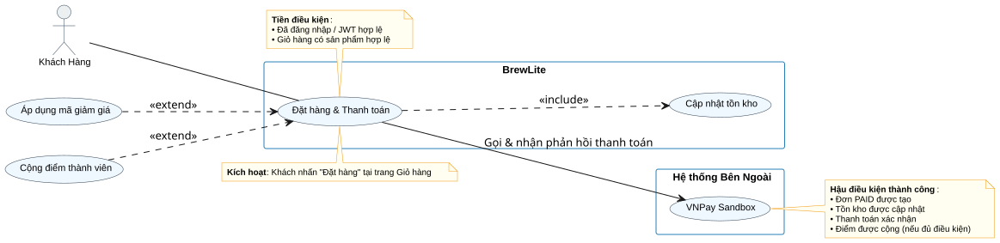

# Task 1.3 – Đặc tả Use-Case Trọng Tâm
## Tên Use-Case: Đặt và Thanh Toán Đơn Hàng
**Hệ thống**: BrewLite  
**Phiên bản**: 1.0  
**Ngày**: 09/11/2026

---

## 1. Biểu đồ Use-Case (phạm vi chi tiết)

---

## 2. Thông tin cơ bản

| Thông tin | Nội dung |
|---|---|
| Tên use-case | Đặt và Thanh Toán Đơn Hàng |
| Mã tham chiếu | UC-05 (từ Task 1.2) |
| Actor chính | Khách Hàng |
| Actor/Hệ thống liên quan | VNPay Sandbox (Cổng thanh toán), Hệ thống BrewLite (Xác thực, Quản lý kho, Khuyến mãi, Tích điểm) |
| Trigger | Khách hàng nhấn nút **"Đặt hàng"** sau khi hoàn tất chọn sản phẩm trong giỏ hàng |
| Tiền điều kiện | 
1. Khách hàng đã xem menu, chọn sản phẩm (size/topping) và thêm vào giỏ hàng — **FR-01, FR-02, FR-03**
2. Khách hàng đã đăng nhập và có JWT Token hợp lệ — **FR-04**
3. Giỏ hàng có ít nhất 1 sản phẩm với số lượng hợp lệ, tổng tiền > 0 — **FR-03**
4. Hệ thống kết nối được cổng thanh toán và dịch vụ điểm thành viên — **FR-06, FR-10**
5. Hệ thống đã kết nối và có dữ liệu tồn kho nguyên liệu hợp lệ — **FR-05**
| Hậu điều kiện — Thành công | 
1. Đơn hàng được tạo với trạng thái **PAID** — **FR-05, FR-08**
2. Khuyến mãi (nếu có) được áp dụng hợp lệ, giảm giá không vượt tổng đơn — **FR-09**
3. Thanh toán được ghi nhận thành công qua VNPay Sandbox / Mock Gateway; không tạo giao dịch trùng — **FR-06**
4. Điểm loyalty được cộng **chỉ khi đơn PAID**, không cộng trùng — **FR-10**
5. Lịch sử đơn hàng được cập nhật, hiển thị trạng thái chi tiết cho khách — **FR-07, FR-08**
6. Thông báo xác nhận hiển thị rõ mã đơn, tổng tiền, trạng thái — **FR-11** 
7. Tồn kho nguyên liệu được **giữ khi tạo đơn PENDING, chỉ trừ vĩnh viễn khi đơn PAID** trong cùng CSDL Transaction — **FR-05, NFR-05**
8. Giỏ hàng của khách hàng được tự động dọn sạch — **FR-03**
| Hậu điều kiện — Thất bại | 
1. Đơn hàng tồn tại với trạng thái **PENDING / PAYMENT_FAILED** — **FR-08**
2. Giữ nguyên trạng thái giỏ hàng, không tự xóa — **FR-11**
3. Không áp dụng khuyến mãi, không trừ/cộng điểm — **FR-09, FR-10**
4. Thông báo rõ nguyên nhân lỗi, hướng cách khắc phục — **FR-11, NFR-03**
5. Nếu đã giữ/chốt nguyên liệu trong kho → tự động hoàn trả lại kho theo đúng một lần — **FR-05, FR-08, NFR-05**
| Mã yêu cầu liên kết | FR-03, FR-04, FR-05, FR-06, FR-07, FR-08, FR-09, FR-10, FR-11, NFR-01, NFR-02, NFR-05 |

---

## 3. Mô tả luồng xử lý

### 3.1 Luồng chính — Thành công
| Bước | Thực hiện bởi | Hành động | Yêu cầu liên kết
|---|---|---|---|
| 1 | Khách hàng | Truy cập trang thanh toán, xem lại giỏ hàng (sản phẩm, size/topping, tạm tính) | FR-03 |
| 2 | Hệ thống | Kiểm tra phiên đăng nhập & JWT hợp lệ; thiếu/sai/hết hạn → trả 401 và dừng luồng | FR-04, NFR-02 |
| 3 | Khách hàng | Nhập thông tin giao hàng, nhập mã khuyến mãi (nếu có) và nhấn "Đặt hàng" | FR-09 |
| 4 | Hệ thống | Kiểm tra tồn kho nguyên liệu đủ cho toàn bộ sản phẩm trong đơn (sử dụng Database Transaction + Optimistic Lock), **giữ/khóa kho khi tạo PENDING** | FR-05, NFR-01, NFR-05 | 
| 5 | Hệ thống | Thẩm định khuyến mãi: kiểm tra hiệu lực, hạn dùng, điều kiện tối thiểu; tính giảm giá không vượt tổng đơn | FR-09 |
| 6 | Khách hàng | Chọn phương thức thanh toán: **VNPay Sandbox** hoặc **Ví/Thẻ nội bộ (Mock)** | FR-06 | 
| 7 | Hệ thống | Tạo đơn hàng trạng thái **PENDING**; tạo bản ghi Payment kèm **Idempotency-Key** để tránh giao dịch trùng | FR-05, FR-06 | 
| 8 | Hệ thống | Nếu chọn VNPay → sinh URL thanh toán có chữ ký **HMAC-SHA512** và chuyển hướng khách hàng | FR-06, NFR-02 |
| 9 | Khách hàng | Xác nhận thông tin thanh toán và hoàn tất tại cổng | -- |
| 10 | VNPay Sandbox / Mock | Trả về kết quả giao dịch; hệ thống **xác minh IPN: chữ ký, mã giao dịch, số tiền** trước khi cập nhật | FR-06, NFR-02 |
| 11 | Hệ thống | Nếu kết quả = **"00" (Thành công)**:• Cập nhật Payment → PAID• Cập nhật Order → PAID• Xác nhận transaction CSDL | FR-05, FR-06, FR-08 |
| 12 | Hệ thống | Xác nhận **trừ vĩnh viễn** số lượng nguyên liệu đã giữ khỏi kho; tăng version bản ghi | FR-05, NFR-05 |
| 13 | Hệ thống | Tính và cộng điểm loyalty; **chỉ cộng 1 lần khi PAID** — không cộng trùng khi IPN gọi lại | FR-10 |
| 14 | Hệ thống | Tự động dọn sạch giỏ hàng; điều hướng đến trang xác nhận đơn hiển thị mã đơn, tổng tiền và điểm đã cộng | FR-03, FR-11 |

### 3.2 Luồng thay thế
| Mã | Xảy ra tại bước | Tình huống | Xử lý & Kết quả | Yêu cầu liên kết |
|---|---|---|---|---|
| ALT-01 | 5 | Mã khuyến mãi không hợp lệ / hết hạn / chưa đủ điều kiện | Thông báo "Mã khuyến mãi không khả dụng"; cho phép nhập lại hoặc bỏ qua → tiếp tục bước 6 | FR-09 |
| ALT-02 | 6 | Khách hàng chọn thanh toán qua Ví/Thẻ mô phỏng nội bộ (Mock Payment) thay vì VNPay Sandbox | hoàn tất đơn không qua cổng thanh toán ngoài; không tạo giao dịch VNPay | FR-06, FR-10 |
| ALT-03 | 13 | Đơn PAID nhưng tài khoản chưa đủ điều kiện tích điểm | Ghi nhận đơn thành công; thông báo "Điểm chưa đủ điều kiện tích lũy"; không cộng điểm nhưng không làm thất bại đơn | FR-10 |

### 3.3 Luồng ngoại lệ
| Mã | Xảy ra tại bước | Tình huống | Xử lý & Kết quả | Yêu cầu liên kết |
|---|---|---|---|---|
| EX-01 | 2–14 | Phiên đăng nhập hết hạn / JWT không hợp lệ | Lưu trạng thái giỏ hàng tạm thời; chuyển hướng đến trang /login với thông báo "Vui lòng đăng nhập lại để tiếp tục"; không mất dữ liệu giỏ hàng | FR-04 |
| EX-02 | 4 | Nguyên liệu/sản phẩm trong kho không đủ / bị đặt trước (optimistic lock conflict) | Hủy transaction; thông báo "Sản phẩm hiện không đủ hàng hoặc đã được đặt trước"; giữ nguyên giỏ hàng; không tạo đơn, không trừ kho | FR-05, NFR-01, NFR-05 |
| EX-03 | 8-10 | Khách hủy giao dịch / VNPay trả mã lỗi ≠ "00" / kết nối thất bại | Cập nhật đơn → PAYMENT_FAILED; **hoàn trả nguyên liệu đã giữ về kho đúng một lần**; giữ nguyên giỏ hàng; hiển thị rõ nguyên nhân; cho phép thử lại hoặc đổi phương thức | FR-06, FR-08, FR-11, NFR-05 |
| EX-04 | 5 | Hệ thống khuyến mãi không phản hồi tạm thời | Thông báo "Không thể kiểm tra mã khuyến mãi, vui lòng thử lại sau"; không áp dụng giảm giá; cho phép tiếp tục đặt hàng | FR-09 |
| EX-05 | 10 | VNPay IPN trả thành công nhưng chữ ký HMAC-SHA512/số tiền không khớp | Bỏ qua cập nhật trạng thái; ghi log cảnh báo; không thay đổi đơn/thanh toán; không gọi hoàn tiền tự động | FR-06, NFR-02 |
| EX-06 | 7 | Gửi Idempotency-Key trùng cho cùng đơn & phương thức | Trả kết quả giao dịch cũ hoặc lỗi 409; không tạo giao dịch trùng; không cộng điểm hai lần | FR-06 |
| EX-07 | 11-12 | Lỗi CSDL sau khi VNPay xác nhận nhưng trước khi commit | Rollback toàn bộ transaction; gọi hoàn tiền qua VNPay nếu cần; hoàn trả nguyên liệu; thông báo lỗi hệ thống; ghi log chi tiết | FR-05, NFR-05
| EX-08 | 9–10 | Mạng gián đoạn / không nhận được phản hồi VNPay quá 30 giây | Thông báo "Đang xử lý, vui lòng chờ hoặc kiểm tra lịch sử đơn hàng"; hệ thống tiếp tục kiểm tra trạng thái sau đó; không tự đánh dấu thất bại ngay | FR-06, NFR-01
| EX-09 | 7–10 | Đơn ở trạng thái PENDING quá 15 phút không thanh toán | Tự động chuyển PAYMENT_FAILED; hoàn trả nguyên liệu về kho; gửi thông báo đơn hết hạn | FR-05, FR-08

---

## 4. Liên kết với Mã Yêu Cầu

| Mã yêu cầu | Nội dung ngắn gọn | Ưu tiên MoSCoW | Liên quan tại bước / Luồng |
|---|---|---|---|
| FR-03 | Quản lý giỏ hàng: xem, thêm, sửa, xóa | Must | 1, 14, tất cả ngoại lệ giữ giỏ hàng |
| FR-04 | Xác thực & quản lý tài khoản JWT | Must | 2, EX-01 |
| FR-05 | Tạo đơn + kiểm tra & trừ tồn kho đồng thời | Must | 4, 7, 11–12, EX-02, EX-03, EX-07 |
| FR-06 | Thanh toán VNPay + Idempotency + IPN | Must | 6–11, ALT-02, EX-03, EX-05, EX-06 |
| FR-07 | Xem lịch sử & chi tiết đơn hàng | Must | 11, 14 |
| FR-08 | Quản lý trạng thái đơn & hoàn kho | Must | 7, 11, EX-03 — State Machine PENDING→PAID/PAYMENT_FAILED |
| FR-09 | Áp dụng & kiểm tra mã khuyến mãi | Must | 3, 5, ALT-01, EX-04 |
| FR-10 | Tích điểm thành viên (chỉ khi PAID) | Must | 13, ALT-03, EX-03 — không cộng khi thất bại/trùng |
| FR-11 | Xác nhận đơn & phản hồi lỗi rõ ràng | Must | 14, tất cả ngoại lệ — không xóa giỏ khi lỗi |
| NFR-01 | Hiệu năng & xử lý đồng thời | Must | 4, EX-02 — optimistic lock, 5 yêu cầu chỉ 1 thành công |
| NFR-02 | Bảo mật JWT, HMAC-SHA512 VNPay | Must | 2, 8, 10 — xác minh IPN, không tin client |
| NFR-05 | Toàn vẹn dữ liệu — Transaction & Rollback | Must | 4, 11–12, EX-02, EX-03, EX-07 — atomic, không oversell |
---

## 5. Tiêu chí Chấp Nhận

### ✅ Hệ thống **LÀM**
- Hiển thị rõ giỏ hàng, tổng tiền trước khi khách xác nhận đặt hàng
- Kiểm tra JWT trước khi xử lý; chuyển đăng nhập nếu hết hạn
- Kiểm tra tồn kho nguyên liệu trong transaction; rollback ngay khi không đủ
- Tính lại giá, giảm giá từ server — **không tin dữ liệu gửi từ client**
- Chỉ cập nhật PAID sau khi IPN VNPay xác minh chữ ký & số tiền khớp
- Idempotency-Key ngăn tạo giao dịch trùng
- Hoàn trả nguyên liệu về kho đúng một lần khi thanh toán thất bại/hủy
- Giữ nguyên giỏ hàng khi có lỗi; chỉ dọn khi đơn thành công
- Chỉ cộng điểm khi đơn PAID; không cộng trùng khi IPN gọi lại
- Thông báo rõ ràng nguyên nhân lỗi cho từng trường hợp

### ❌ Hệ thống **KHÔNG LÀM**
- Không chuyển đơn sang trạng thái PAID khi chưa nhận được xác nhận hợp lệ từ cổng thanh toán
- Không bán quá số lượng nguyên liệu trong kho
- Không cập nhật PAID chỉ từ Return URL của VNPay
- Không cộng điểm cho đơn PAYMENT_FAILED/PENDING
- Không áp dụng khuyến mãi sai điều kiện/hết hạn
- Không mất dữ liệu giỏ hàng khi đăng nhập hết hạn
- Không tạo giao dịch thanh toán trùng lặp

### 📋 Bộ kiểm thử gợi ý
| Mã TC | Tình huống mong đợi | Kết quả chấp nhận |
|---|---|---|
| TC-1.3-01 | Đơn hợp lệ + áp dụng KM hợp lệ + thanh toán VNPay thành công | Đơn PAID, giảm giá đúng, kho trừ, điểm cộng, giỏ trống, hiển thị xác nhận |
| TC-1.3-02 | 5 yêu cầu đặt cùng lúc, kho đủ cho 1 đơn | Chính xác 1 thành công, 4 bị từ chối an toàn, không có kho âm |
| TC-1.3-03 | Nhập mã khuyến mãi sai/hết hạn | Thông báo lỗi, không áp dụng giảm giá, cho tiếp tục đặt hàng |
| TC-1.3-04 | VNPay IPN trả thành công nhưng chữ ký sai | Từ chối cập nhật trạng thái (giữ nguyên PENDING), không cộng điểm loyalty, ghi log cảnh báo bảo mật |
| TC-1.3-05 | Gửi cùng Idempotency-Key 2 lần cho cùng đơn | Lần 2 trả kết quả cũ/409, không tạo giao dịch trùng |
| TC-1.3-06 | Khách hủy tại trang VNPay trước khi xác nhận | Đơn PAYMENT_FAILED, nguyên liệu hoàn trả, giỏ nguyên vẹn, có thể đặt lại | 
| TC-1.3-07 | Token hết hạn khi đang ở bước thanh toán | Chuyển về /login, giỏ hàng được lưu, không mất dữ liệu |  
| TC-1.3-08 | Đặt hàng khi nguyên liệu không đủ trong kho | Thông báo hết hàng, không tạo đơn, không trừ kho, giữ giỏ hàng |
| TC-1.3-09 | Thanh toán thành công nhưng lỗi CSDL trước commit | Rollback hoàn toàn, hoàn tiền & kho, thông báo lỗi, không tạo đơn |